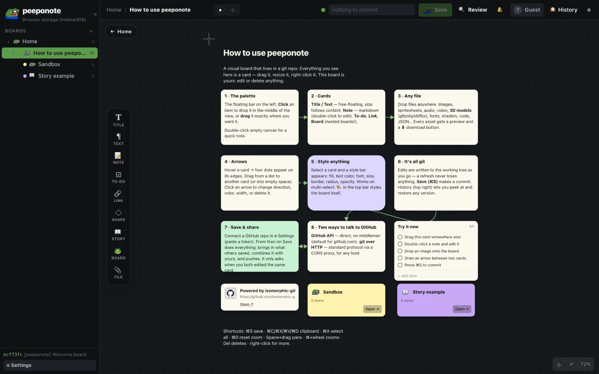
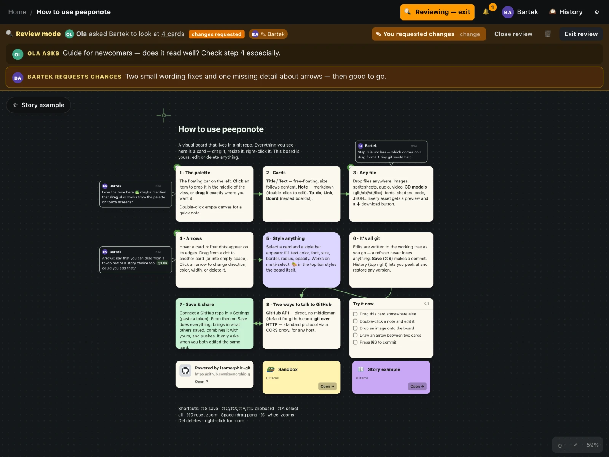
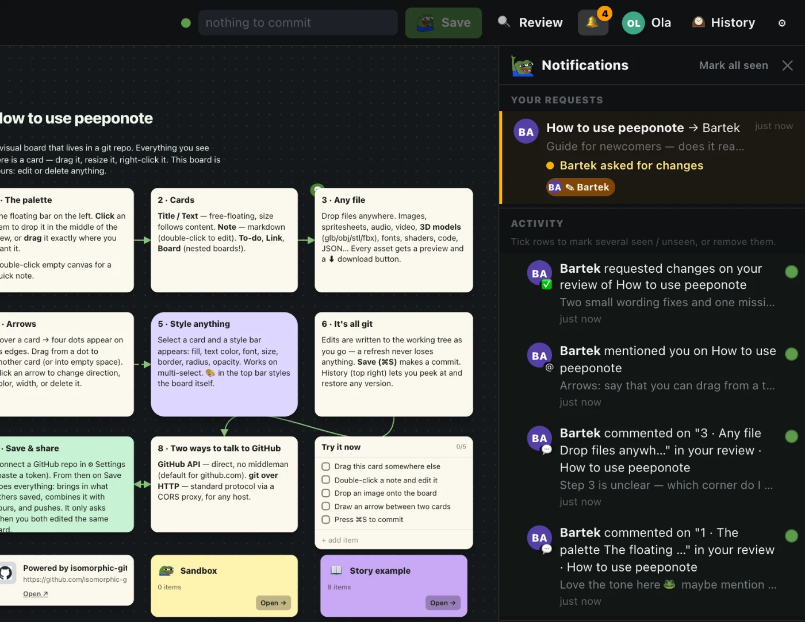
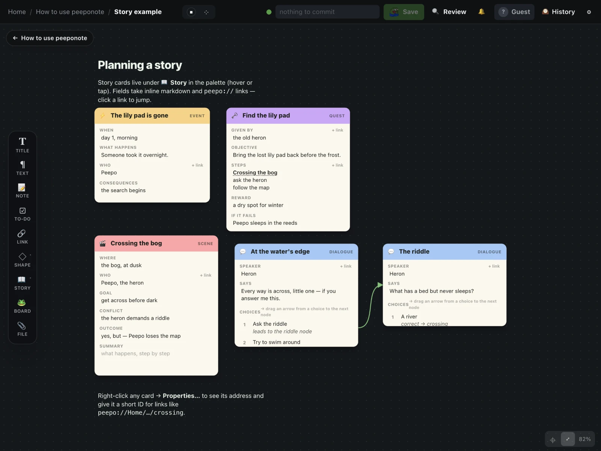

<p align="center"></p>

<h1 align="center">peeponote</h1>

<p align="center"><b>Visual boards on an infinite canvas where Save = <code>git commit</code>.</b><br>
Your repo is the backend: no server, no database, just a static PWA.</p>

<p align="center">
  <a href="https://mikolajpochec.github.io/peeponote/"><b>▶ Open peeponote</b></a> &nbsp;·&nbsp;
  <a href="CHANGELOG.md">What's new</a> &nbsp;·&nbsp;
  <a href="#develop">Develop</a>
</p>

<p align="center">
  <a href="https://github.com/mikolajpochec/peeponote/releases/latest"></a>
  
  
  <a href="https://github.com/mikolajpochec/peeponote/stargazers"></a>
</p>

<p align="center"></p>

## What it does

- **Put anything on the canvas.** Text, markdown, to-dos, links, shapes, nested boards and any file
  with a live preview (images, audio, video, 3D models, fonts, code). Connect them with arrows.
  Works on phones too.
- **It's all git.** Boards are plain JSON in `boards/`, files go in `assets/`. Diff, branch and
  merge them, in any repo, even a monorepo subfolder.
- **Save is a commit.** Connect a GitHub repo (or any git host via the CORS proxy) and Save
  commits, pulls, merges card by card and pushes. It only asks when two people edited the same
  card, and unsaved typing survives a crash.
- **Review on the board.** Ask for a review, leave comment bubbles that point at cards, approve
  or request changes and `@mention` people. Reviews are files in the repo and notifications come
  straight from it.
- **Plugins for your kind of work.** **Story** plans scenes, quests and dialogue with choices;
  **Code** draws flowcharts with decisions, loops and labelled lines.
- **Reads well for Claude and the terminal.** `cli/peepo.mjs` prints boards as markdown (`tree`,
  `show`, `search`, `graph --mermaid`), and `cli/SKILL.md` makes it a Claude Code skill.

<table>
  <tr>
    <td width="33%"></td>
    <td width="33%"></td>
    <td width="33%"></td>
  </tr>
  <tr>
    <td align="center"><b>Review</b> in the repo</td>
    <td align="center"><b>Notifications</b> from git</td>
    <td align="center"><b>Story</b> planning</td>
  </tr>
</table>

## Develop

```sh
bun install && bun dev        # http://localhost:5173
bun run build                 # → dist/, deployed to GitHub Pages on push to main
bun scripts/fetch-peepos.ts   # refresh peepo emotes from 7TV
```

Peepos from [7TV](https://7tv.app) · git in the browser by [isomorphic-git](https://isomorphic-git.org)
